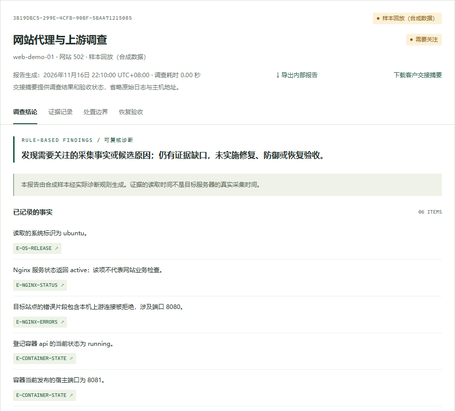

# OpsArk

OpsArk 是面向个人站长和小团队的自部署 VPS 运维工具。网站突然返回 502 时，它把 Nginx、上游端口和容器状态汇到一份报告里，让你看到支持判断的证据、可能的原因和还缺哪些检查。处置后可以核对原任务、复验业务，再把验收状态导出为脱敏交接摘要。

[下载社区试用版](https://github.com/mingzitaichangduozaishuhoumian/ops-ark-community/releases/tag/v0.19.0-community.1) · [本地快速开始](#开始试用) · [看样例报告](docs/REPORT_SAMPLES.md) · [实测服务器规格](#小型-vps-部署规格)

**先在本机用样本体验。** 首次启动使用手动模式，SSH 清单为空。AI 可选，模型只能收到通过白名单校验的结构化摘要。 [权限与数据边界](docs/SECURITY_MODEL.md)

## 开始试用

Windows 和 Ubuntu WSL2 已验证首次安装、样本回放和重启读回。网站 502、磁盘异常和容器反复重启都能本地回放，只需要 uv、浏览器和下载依赖的网络。

下载发行页附件 `ops-ark-community-0.19.0-community.1.zip`，对照 `SHA256SUMS.txt` 核对后解压。安装 uv，在含 `pyproject.toml` 和 `uv.lock` 的源码根目录打开一个没有 OpsArk 部署变量的新终端，运行下面两行。首次同步会下载锁定依赖，也可能下载 Python 3.13。 [发行页](https://github.com/mingzitaichangduozaishuhoumian/ops-ark-community/releases/tag/v0.19.0-community.1) · [uv 安装说明](https://docs.astral.sh/uv/getting-started/installation/)

```console
uv sync --locked --no-dev --python 3.13
uv run --locked --no-dev python -m uvicorn opsark.main:app --app-dir src --host 127.0.0.1 --port 18190 --workers 1
```

打开本地控制台，填入首次启动生成的 `data/access-token` 文件内容。选择「站点上游与容器端口不一致」样本，点击「运行只读调查」。报告会显示「需要关注」，在「证据记录」中可以查看模拟的上游连接失败。点「下载客户交接摘要」，导出的 `opsark-handoff.md` 会标记「待验收」。重启后可以在「最近报告」中找回同一份报告。 [本地控制台](http://127.0.0.1:18190/) · [首次运行与故障排查](docs/COMMUNITY_TRIAL.md)



*社区试用版控制台截图，使用内置的 502 合成样本。*

## 小型 VPS 部署规格

| 部署方式 | 实测规格和范围 |
| --- | --- |
| **整机部署起步参考** | **1 vCPU / 1 GiB RAM / 无 swap**。Ubuntu 24.04 隔离来宾机同时运行系统、Docker、OpsArk 和轻量 Nginx，完成安全扫描、单包更新、服务激活和业务复验。轻载验收中，整机最低可用内存约 282 MiB。[整机容量验收](docs/CAPACITY_ACCEPTANCE.md) |
| **独立控制台** | 控制台曾在 **0.25 vCPU / 128 MiB RAM / 无 swap** 的容器限制下完成启动、认证、本地样本回放和摘要导出。该容量测试覆盖单控制台的本地回放。[控制台资源实测](docs/RUNNING.md#资源占用与小型-vps) |

整机的 1 GiB 数据适用于上述轻载场景。512 MiB 整机、数据库与多目标并发尚无容量验收；实际部署按业务、日志和备份用量预留资源。

## 调查与接入

接入真实服务器时，先核对 SSH 主机指纹，使用独立的专用账号和受限只读入口，登记站点或容器后运行预检。预检逐项显示系统、工具、服务和权限缺口。 [SSH 登记与预检](docs/RUNNING.md#登记-ssh-主机) · [服务端只读入口](deploy/readonly/README.md)

| 场景 | 报告与证据 |
| --- | --- |
| 网站 502 | 关联 Nginx、登记上游、监听端口和容器状态。启用站点日志窗口后可查看上游拒绝连接和超时计数，采集缺口会随报告显示。[Nginx 日志窗口](deploy/readonly/README.md#nginx-错误日志窗口) |
| 磁盘异常 | 查看可用空间和 inode，比较同一登记范围的增长。根据文件类别和占用证据给出条件回收估计，包括已经删除但仍被进程持有的文件。[磁盘证据](docs/DISK_RECLAIM_EVIDENCE.md) |
| 容器反复重启 | 关联退出码、OOM 标记、重启次数和状态。具备同范围历史基线时，比较容器、镜像和 Compose 配置变化。[容器调查与复验](docs/RUNNING.md#容器调查业务复验) |
| 应用依赖 | 在已授权的 Compose 项目中查找服务和端口候选，由操作者确认后再登记。将 Nginx 磁盘配置里的站点和上游与已登记服务关联，并标记共享关系或未知项。[Compose 发现](docs/COMPOSE_DISCOVERY.md) · [Nginx 依赖](docs/NGINX_DEPENDENCIES.md) |

## 持续观察与 AI 分析

- **SSH 与 Web 观察**  在登记范围内定期采集。控制台呈现 SSH 异常、Web 探测特征、错误集中和慢请求告警，保留覆盖缺口和历史证据，并对重复采集去重。[SSH 观察](docs/SECURITY_OBSERVATION.md) · [Web 观察](docs/WEB_SECURITY_OBSERVATION.md)
- **漏洞公告观察**  在支持的 Ubuntu 环境中将已安装包与供应商公告和修复版本匹配。符合条件的漏洞告警可配置签名 HTTPS Webhook。[漏洞观察与通知](docs/VULNERABILITY_WATCH.md#可选签名-webhook)
- **可选 AI 分析**  可请求模型解释调查结果、分析告警或提供漏洞处置候选建议。支持 OpenAI 兼容接口和 Anthropic 接口。发送前校验结构化白名单，发现敏感内容或无法分类的数据就阻断整次外发。受限执行端独立生成并校验实际修复方案，执行权限由各动作的授权规则决定。[模型设置](docs/RUNNING.md#可选模型解释) · [AI 外发边界](docs/AI_EGRESS_RELEASE_CHECK.md)

## 受控处置与业务复验

首次启动是手动模式，SSH 清单为空。部署者可按所需的处置方式配置权限。

| 模式 | 系统行为 |
| --- | --- |
| 手动 | 收集证据，提供候选原因与处置建议。 |
| 半自动 | 预览目标、动作和影响，人工确认后执行受支持的动作。 |
| 全自动 | 对受支持的 Ubuntu 24.04 单包安全修复，按预先登记的目标、软件包、时间窗和限额自动执行。暂停后可停止新的自动派发。[预授权自动修复](docs/AUTOMATIC_REPAIR.md) |

已实现的受控动作包括 Ubuntu 单包安全更新、已登记服务激活、已登记的 Nginx 上游变更及回退，以及已登记容器重启。每类动作分别登记目标、配置执行入口和授权。[补丁修复](docs/VULNERABILITY_REMEDIATION.md) · [服务激活](docs/SERVICE_ACTIVATION.md) · [Nginx 变更](deploy/nginx/README.md) · [容器重启](deploy/container/README.md)

回执丢失时按原任务身份查回状态。业务复验依据已登记的只读检查。出现明确失败时标记「复验未通过」，超时或证据不足时保留「待验收」，登记项全部通过后标记「复验通过」。旧记录和对应交接摘要可以再次打开。[原任务恢复](docs/RECOVERY.md) · [客户交接验收](docs/HANDOFF_LAB.md)

## 交接、备份与恢复

- **客户交接摘要**  导出 Markdown，汇总调查结论、审批与执行状态、原任务回执和业务复验。公开反馈使用合成样本，真实日志、凭据和业务数据留在本地。
- **控制端加密备份**  使用 age 离线封装控制端十库，并按支持的交接清单纳入配置。接收方先校验密文并完成认证，再恢复到新的私有目录。独立凭据分开保管，恢复配置保持未启用。[备份与恢复指南](docs/SEALED_BACKUP.md)

## 平台与部署范围

控制台、本地浏览器、被管理服务器和写入动作分别验收。社区首试以 Windows 和 Ubuntu WSL2 的本地回放为主，Debian 13 容器也已验证控制台调查和重启读回。优先在 Ubuntu 24.04 x86-64、宿主 Nginx 和同机 rootful Docker Compose 的隔离环境试用真实接入。托管检查包含 Ubuntu/Debian 的受限 SSH 与 Nginx 场景。备份工具、服务激活和写入动作的具体版本及验收范围以各自文档为准。[平台矩阵](docs/PLATFORM_SUPPORT.md) · [运行与接入](docs/RUNNING.md) · [隔离 VPS 试用](docs/COMMUNITY_TRIAL.md#再试一台隔离-vps)

## 反馈与贡献

- 安装卡住或走完试用，都可以用「试用反馈」记录版本、系统和完成到哪一步。[反馈入口](https://github.com/mingzitaichangduozaishuhoumian/ops-ark-community/issues/new/choose) · [反馈填写说明](CONTRIBUTING.md#提交试用反馈)
- 可稳定复现的问题可用 **Issues → New issue → 缺陷反馈**，说明预期与实际结果。 [贡献说明](CONTRIBUTING.md)
- 涉及 OpsArk 自身的安全问题，请通过私密入口报告。 [安全报告流程](SECURITY.md)
- 验收用例、隔离环境和发布核对见[发布检查](docs/RELEASE_CHECK.md)。权限与敏感数据处理见[安全说明](docs/SECURITY_MODEL.md)。

OpsArk 核心以 [Apache-2.0](LICENSE) 开源。部署和维护支持可单独提供。
