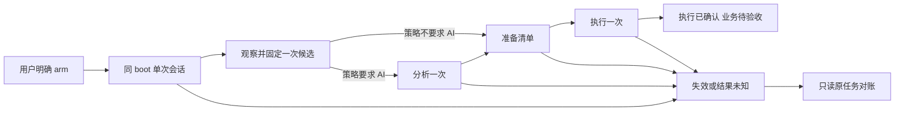

# 显式 arm 后的单次自动会话

本功能仍是默认关闭的开发候选，已在两台授权服务器的新私有隔离环境完成单次会话验收。它只在部署者已配置的固定防护范围内，使用用户明确 arm 的原观察窗口，最多调用一次模型、执行一个允许的动作。它不自行 arm、不签发或续期 Root 许可、不延长原 120 秒窗口或 60 秒动作 TTL，也不自动 revoke；这些实验不构成长期或公网自主防御支持。

部署端开关为 `OPSARK_DEFENSE_SESSION_ENABLED`，默认 false；启用需要已有独立防护登记和策略。它与尚未开放的 `OPSARK_DEFENSE_WORKER_ENABLED` 分开，持续执行能力保持 false。固定 Compose 与加密交接 v2 模板没有改动，恢复工具不加载或执行原 `.env`。

隔离目标的文件、三角色、双层授权和独立进程接线见[接入清单](DEFENSE_SESSION_SETUP.md)。固定 Compose 不透传会话开关或相关文件引用，不能仅在 `.env` 加一行就启用。

## 进入条件

当前模式必须为 automatic，控制端和 Root 两层授权均有效，模式、版本与同步 ACK 完整。会话绑定原 cursor、同一个控制端 boot owner、首次 worker lease epoch、完整模式快照、目标和公开信任材料。先前未 arm、缺 ACK、窗口已过或其他进程创建的观察不能变成新自动许可。

允许在尚无合格候选时进入 observing；候选到达后只能选择一次，继续使用原 Controller created/deadline。Root 的 UTC deadline 只用于精确绑定，不能直接减本地时间来发明新的窗口。

## 执行与停止

规则路径仅在原策略不要求 AI 时可用，并明确没有模型调用。策略要求 AI 时，提供方或同意不符、拒绝、未知、proof 失效、计数变化或出现另一候选都会停止；不换分析 ID、不重收费、不切提供方，也不降级为规则执行。

内部单次预算为 AI 最多 20 秒、每次 SSH RPC 最多 10 秒，原显式接口保持原默认预算。AI 费用前至少保留 55 秒，准备前至少 35 秒，执行前至少 15 秒，包含收尾余量；需要额外只读刷新时再预留该次查询预算。剩余不足提前停止，不保证晚到候选赶得上观察窗口。模型总超时还受原选定证据剩余 30 秒有效期约束，并预留 5 秒余量；已经付费的调用不会重新发送。

慢模型或慢 SSH 不能靠延长证据有效期继续执行。AI 输入固定后不修改原选择、permit 或 proof；分析完成后如需刷新，只能在原 owner、lease epoch、模式、grant 和截止时间仍有效时查询同一个 cursor。新回执的全部候选和证据必须与原选择完全一致，再通过普通 30 秒门禁才能继续。刷新凭据不能用于修改操作，原有 120 秒窗口、使用量和 AI 费用也不会重置。

租约检查贯穿 AI 费用提交、action/request/AI sidecar 绑定、发送许可、SSH exec/stdin 两个检查点，以及回执和模型结果提交。数据库写入与 fence 在同一事务内；HTTPX 真正进入 transport 前再次核对派发许可。已经在途的外部操作不能撤回，失效后不将其晚到结果写成新的可信成功。

停止会话不等待模型或 SSH 输出，先使持久阶段失效；原意图、费用和历史保留。准备或执行意图已持久化后发生未知、中断、owner 丢失或新 epoch，只能读取原记录并查询原 RID。`ready` 不是重放许可，内核集合为空也不清使用量或 latch。独立人工撤销仍有自己的精确确认和授权，不借用会话许可。

## 历史与业务验收

新会话、选择、AI、action 和 request 只使用 `security.sqlite3` 中的新 sidecar，不改变旧 `DefenseContext`、`AIUsagePermit`、请求字节或 canonical proof。历史读取不要求活租约，新进程不能接管旧发送 owner；同 boot 重新取得不同 epoch 也不能续接旧会话。

后台每五秒串行观察本 boot 明确启动的会话，不扫描旧记录来取得发送权。已经推进的执行阶段在一个周期内最多继续八步，各步仍重新检查权限和证据；状态未变化、候选未到达或已终止时停止本次推进，避免空转，也避免纯阶段等待耗尽证据时效。配置未启用、没有本进程会话时不发网络请求。会话启动回应丢失时保留原 host、cursor 和稳定 session_ref，只 GET 原会话；切换主机不能把原 ref 拼到另一主机路径，也不能自动重新 POST。

## 控制台入口

| 接口 | 固定用途 |
| --- | --- |
| `GET /api/ssh-defense/sessions/status` | 读部署开关与单次会话状态，不授予权限 |
| `GET /api/hosts/{host}/ssh-defense/sessions` | 本地分页读该原主机会话历史 |
| `GET /api/hosts/{host}/ssh-defense/sessions/{ref}` | 读取精确原会话，未知回执后不重启执行 |
| `GET /api/hosts/{host}/ssh-defense/sessions/{ref}/ai-receipt` | 纯本地核对原会话 AI 安全回执，无模型、SSH 或额度写入 |
| `POST /api/hosts/{host}/ssh-defense/sessions` | 明确原 cursor、稳定 ref、模式版本及 `confirm_session:true` |
| `POST /api/hosts/{host}/ssh-defense/sessions/{ref}/stop` | 精确声明摘要及 `confirm_stop:true`，使本 boot 会话失效 |

接口沿用控制台认证，不接受任意目标地址、prompt、Shell、动作预算或原始配置。网页不能开启部署端开关。手动模式和新进程仍可查看旧历史并打开原任务只读查询；新进程不会把无法停止的旧会话显示成“已停止”。显式只读对账每次可以取得新的原任务状态，不因先前失败或成功而永久缓存；内部自动收尾则有防重复限制。

本阶段执行已确认仍显示业务待验收。Root active、自然到期、会话 completed 或告警已阅，都不代替独立业务复验。后续复验继续绑定同一原任务、执行前 profile 和实际小回执。

界面始终保留启动按钮，并用七项本地条件说明为何禁用。原观察窗口采用控制端提供的剩余毫秒数，从本次请求开始按浏览器 `performance.now()` 保守扣时；不比较 Root UTC 与浏览器时钟，不以倒计时替代服务端最终准入。过期及确认提交前都会重新检查，缺少窗口数据或旧进程建立的观察保持禁用。

原 AI 回执只有九个固定字段：`v/session_ref/analysis_id/status/decision/usage_state/input_digest/proof_sha256/actions_executable`，最后一项始终 false。不要求当前提供方、活租约或在线目标，也不重新调用模型；原来源、sidecar、permit、结果、证明和本地额度在同一只读事务核对，矛盾则整次拒绝。无意图区分 `not_required/not_started`；结果缺失保持 unknown，额度保留原 reserved/consumed/unknown。这是本地调用额度，不是提供方扣款证明。历史回执独立显示，不会成为当前新动作的批准依据。

这组界面及接口已通过 252 项联合回归；只读历史驱动另有 24 项回归。随后用三份真实原任务的十库副本完成[实际进程与浏览器验收](../tests/defense_session_receipt_history_lab/README.md)：模型配置和后台均关闭，仍能从界面读回原 AI/规则/丢 ACK 历史；零 SSH、零模型、零写请求，原件与副本十库逻辑保持一致。此范围不等于在两台服务器重新执行了新版本动作。

## 当前验证边界

存储、租约、费用、真实派发检查点和本地编排已用临时合成数据、FakeRoot 与 MockTransport 验证；Mock HTTP 不等于真实模型或 SSH。Main、部署开关、界面及后续实机结果以各自记录为准，不能由单元测试推导已经部署或支持长期自主防御。常驻实例与权限不因本开发分支变化而扩大。

本地新旧联合回归为 364 项通过、零失败，覆盖会话、原 API、只读跟进、原进程恢复、业务复验与十库归档。独立审查分别核对 Base/Service、AI 派发、编排和 Main/API/界面；已复现并修复三个问题：客户端构造后失效仍发 HTTP、显式对账被旧结果永久缓存、切换主机后的未知引用查询错路径。原 Model 输出校验、白名单及 legacy proof 格式保持，修复没有降低失败门禁。

发送检查与回执写入仍是不同边界：租约在 exec 与 stdin 之间丢失会拒绝发送；在服务层检查后、数据库接收前换主也会拒绝落回执。物理操作已经发生时，原消耗和意图保留，只能通过原 RID 重新查询。两个竞态都保留为回归，而不是用重复执行取得成功。

两个归档用例进一步核对 session/selection/AI/action/request sidecar、原费用/proof、worker epoch、索引/rowid 及 WAL-only 状态；恢复不启动网络、线程或模型，新 Store 不接受旧 opaque admission，同 owner 新 epoch 不能续接。它不是新的原生 age、实际 Root 或权限平台验收。

另已复现每阶段固定等待造成的有效证据耗尽，并加入 elapsed-time 回归：模型 19.99 秒、RPC 9.99 秒及阶段间 5.01 秒的组合仍保持原任务和单次费用；候选变化、接收后换 epoch/模式/grant、停止或到期都会拒绝继续。独立复核直接把 31 秒旧证据的刷新凭据传给真实 Service.prepare，确认普通门禁拒绝且不增加 Root 请求或费用。以上仍使用合成数据和受控传输，实机范围另行记录。

2026-11-06 的新一轮固定版本联合回归为 368 项通过、零失败；随后原生故障字段修正的 33 项驱动回归另行通过，不重复相加。此前一次联合运行与驱动修改重叠，留下两项 AI 校验失败，完整记录保留；固定版本新进程重跑后闭合。

两台各完成规则正常 ACK、真实 OpenAI 兼容 API 正常 ACK、真实 SSH socket 丢 ACK 三个独立场景，共六份成功验收、十二个实际控制端进程、每场景一次 apply、总共两次实际模型调用。浏览器仅 mode/arm/start，prepare/apply 来自正式后台；第二进程只查询原 RID，不重放、不收费。丢 ACK 的会话始终 reconciliation_only，原执行未知费用保留，查询确认也不升格 completed。六场景均未做业务复验，摘要保持待验收。

首轮 `试验机 A` 丢 ACK 因驱动把原生 `fault_layer` 误读成 `layer` 而验收失败；原任务已执行一次且停止在只读对账，其失败报告仍保留。只修驱动字段并增加别名拒绝回归后，使用全新授权与隔离场景验证，没有重跑原任务。[完整范围与证据摘要](../tests/defense_session_lab/README.md)记录两份真实提交、相同生产源码及独立失败；七轮实验资源与私有阶段目录均已清理，常驻实例、原配置、历史和权限未改。
